# 🐠 GitQuarium (깃콰리움)
> Your commits and PRs swimming as living pixel fishes in real-time.

<p align="center">
  
</p>

<p align="center">
  
  
  
  
</p>

---

## 🌊 Overview
**GitQuarium** turns your daily Git commits, pushes, and PR merges into living, swimming pixel fishes in your GitHub Profile README and macOS Menu Bar.

- **TypeScript commits** spawn glowing **Type Jellyfishes** 🪼
- **Daily commits** school as quick **Neon Tetras** 🐟
- **Bug fixes** inflate spiky **Puffy Blowfishes** 🐡
- **Major PR milestones** summon the legendary **Galaxy Whale** 🐋

---

## 🎣 How It Works (The Fishing Loop)

| Git Action | In-Game Trigger | Catch Result |
|---|---|---|
| `git commit` | Cast Fishing Rod 🪱 | Bait quality scales with commit message & lines changed |
| `git push` | Float Bobbing 🌊 | Underwater ripples & shadows appear |
| `PR Merge` | Reel In! 🎣 | **Catch of the Day!** New fish enters your tank |
| `CI Failure` | Snapped Line | Snags old boots, sea debris, or poisonous blowfish |

---

## 🎨 Dual Theme System
- **Theme 1: Retro Pixel Classic (Default)** — Blocky pixel-art aesthetic matching GitHub's contribution grid.
- **Theme 2: Neon Deep Sea Glow** — Modern dark vector theme with glowing bioluminescent creatures.

---

## 🚀 Embed in Your GitHub Profile
Add this single line to your GitHub profile `README.md`:

```markdown

```

---

## 🛠️ Tech Stack
- **Web & Engine**: Next.js 15, TypeScript, Tailwind CSS, SVG Animation Engine
- **Desktop Companion**: macOS Menu Bar (Tauri v2 / Swift)
- **Data Pipeline**: GitHub REST & GraphQL API

---

<p align="center">
  Made with 💙 by <a href="https://github.com/project-hh-com">project-hh-com</a> & <a href="https://github.com/dahee90522">@dahee90522</a>
</p>
